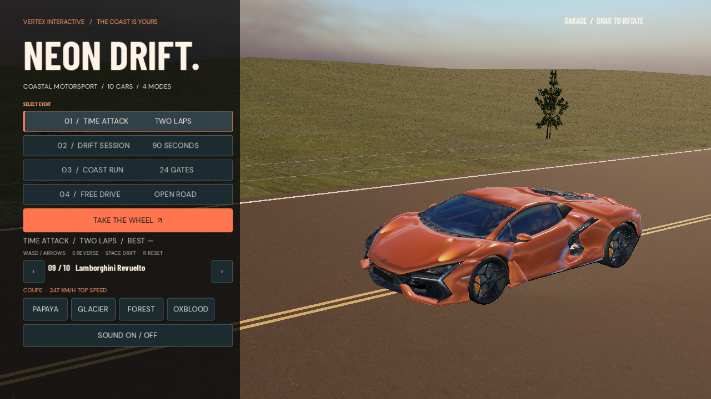
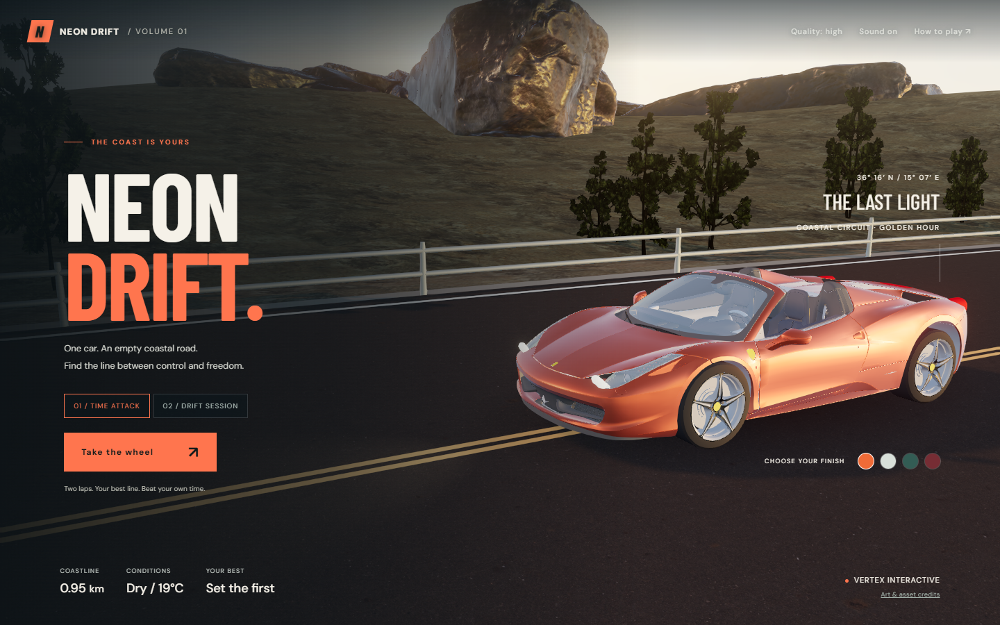
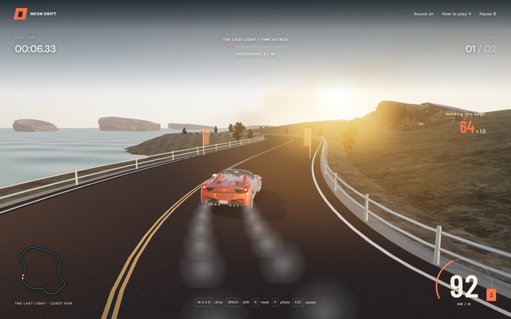

# NEON DRIFT

**A coastal driving game for Godot and the browser.**

The native Godot edition now has **10 licensed 3D cars**, a **3.3 km circuit**, reverse gear, an orbiting garage camera, and four modes. It runs as a desktop game; the browser edition remains playable online.

[**Play on phone or browser →**](https://vertex-blip.github.io/neon-drift/) · [**Download Windows game →**](https://github.com/Vertex-blip/neon-drift/releases/download/v0.2.0-native-preview/NeonDrift-Windows.zip) · [**Open Godot source →**](godot/project.godot)



## Godot edition

| Mode | Goal |
| --- | --- |
| Time Attack | Two ordered laps through 24 gates. |
| Drift Session | Build a drift score in 90 seconds. |
| Coast Run | Complete one lap through 24 gates. |
| Free Drive | Drive the coast without a time limit. |

The garage lets you switch among ten detailed models, choose a paint finish, and drag with a mouse or finger to rotate the view. Driving supports keyboard, gamepad and landscape touch controls. Reverse engages by holding brake after stopping. The native version includes handbrake slip, tyre smoke, brake lights, chase cameras, local records, and synthesized engine, wind and tyre audio.

To run from source, open [`godot/project.godot`](godot/project.godot) in **Godot 4.7.2** and press **F6** or **F5**. The project has Windows and Android export presets. The Android preset is prepared but an APK has not been tested on a physical device.

On a phone, open the web link in a browser, rotate to landscape and tap **Take the Wheel**. This currently launches the earlier browser edition with one car and two modes. The expanded ten-car Godot edition is available as the Windows download and source project; it does not yet have an Android APK.

| Native control | Action |
| --- | --- |
| W / ↑ | Accelerate |
| S / ↓ | Brake, then reverse at a stop |
| A, D / ←, → | Steer |
| Space | Handbrake |
| R | Recover to road |
| C | Switch camera |
| Esc | Pause |
| Drag car in garage | Rotate showroom camera |

The 3D car models and scenery have individual **CC BY 4.0** attributions in [Godot credits](godot/CREDITS.md). The terrain and sky textures are from Poly Haven under CC0. This is an independent arcade game; its current handling and synthesized audio are not a calibrated driving simulator or recordings of the named cars.

## Browser edition

A playable, open-source 3D browser racing game. Drive a detailed convertible around an original coastal circuit at golden hour. Chase a clean two-lap time or spend 90 seconds linking slides.

[**Play Neon Drift →**](https://vertex-blip.github.io/neon-drift/)



## The web drive

| Mode | Objective |
| --- | --- |
| Time attack | Complete two laps through all 16 checkpoints, in order. Beat your personal best. |
| Drift session | Reach 10,000 drift points in 90 seconds. Sustained slides build a multiplier up to ×5. |

The game includes momentum-based arcade handling, handbrake slip, barrier collisions, tyre smoke and skid marks, rotating wheels, brake lights, two chase cameras, and a paused orbit camera for photos. Engine harmonics, gear changes, wind, tyre slip, checkpoint cues, and impacts are synthesized in the browser and synchronized with driving.

The coast uses locally hosted PBR textures, scanned rocks, botanical tree renders, an HDR sky, animated water, shadows, restrained bloom and SMAA. Four paint finishes are available. Personal records and paint preferences stay in browser storage. No login, paid API, analytics, or runtime CDN is required.



## Controls

| Input | Action |
| --- | --- |
| W / ↑ | Accelerate |
| S / ↓ | Brake |
| A, D / ←, → | Steer |
| Space | Handbrake / initiate a slide |
| R | Recover onto the road; adds 3 seconds in time attack |
| C | Switch chase camera |
| P | Enter / leave photo mode |
| Escape | Pause / resume |

Touch gameplay uses **landscape orientation** with steering on the left and throttle, brake and handbrake on the right. Starting requests fullscreen and orientation lock where the browser supports them. On iOS and other browsers that do not permit locking, rotate the phone manually: a portrait overlay freezes the simulation until it is landscape again. The pause menu includes recovery and graphics quality controls. Opening instructions, switching tabs or losing window focus pauses the run. Audio starts only after user interaction; the Sound button mutes all game audio.

**Driving tip:** brake before a tight turn, release the brake, turn in, and apply a short handbrake input. A long slide is worth more than a fast barrier hit.

## Run locally

Use Node.js **22.12 or newer** and a browser with WebGL 2 and hardware acceleration.

```sh
npm ci
npm run dev
```

Open the localhost URL printed by Vite. Production build and preview:

```sh
npm test
npm run build
npm run preview
```

The production build is static and uses relative asset paths, so it can be hosted under a GitHub Pages repository path. The included workflow tests, builds and deploys `main` through GitHub Pages Actions.

## Structure

```text
src/
  main.js       UI, session lifecycle, checkpoints and camera
  game.js       Pure driving simulation and race rules
  track.js      Circuit geometry, scenery, water and lighting
  car.js        Detailed model, animation, smoke and skid marks
  audio.js      Synthesized engine and effects
  engine.js     Rendering, input, persistence and shared helpers
  styles.css    Responsive game interface
public/assets/  Locally hosted models, textures, fonts and decoder
tests/         Deterministic simulation and scoring tests
docs/          Actual browser captures and verification notes
```

## Scope and performance

The web edition has one circuit and one vehicle. The Godot edition expands the garage, circuit and modes. Neither edition has online multiplayer, traffic, vehicle damage simulation or a career campaign.

Select **Quality: light** if the GPU struggles; it reduces render resolution and disables shadows and bloom. Mobile controls are included, but the best visual experience is on a desktop GPU. A first load downloads the locally hosted art assets; this release does not install an offline service worker. If browser storage is disabled, play still works but records may not persist.

## Verification

`npm test` covers acceleration and braking, left/right steering, handbrake slip and recovery, frame-rate stability, checkpoint ordering, two-lap completion, drift combo scoring and timeout, barrier response, and time display. Browser checks exercise actual keyboard and pointer input, audio startup, pause/resume, complete races, saved records, paint selection and responsive layouts. See [verification notes](docs/VERIFICATION.md).

## Credits and license

Game code is MIT licensed. Third-party art and fonts retain their own licenses. See [CREDITS.md](CREDITS.md) for authors, sources, modifications and license links. This project is not affiliated with Ferrari, Poly Haven, or Three.js.
